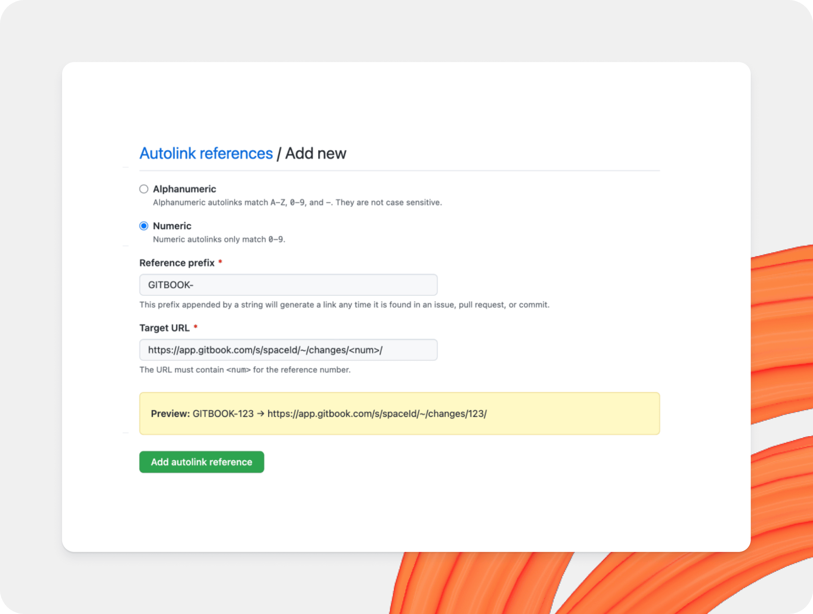

# Commit messages & Autolink

By default, when exporting content from GitBook to the Git repository, GitBook will generate a commit message based on the merged change request:

```
GITBOOK-14: Improve documentation about users management
```

## Autolink `GITBOOK-<num>` in GitHub and GitLab

If you want to automatically resolve your GitBook change request IDs (e.g. _GITBOOK-123_) in commits to links, you can enable this using GitHub’s _Autolink references_ feature. See instructions on [GitHub](https://help.github.com/en/github/administering-a-repository/configuring-autolinks-to-reference-external-resources).

Use the following URL format, where `spaceId` corresponds to your section’s URL:

`<https://app.gitbook.com/s/{spaceId}/~/changes/<num>/>`

<div data-full-width="false"><figure><figcaption><p>Autolink setup.</p></figcaption></figure></div>

## Customize the commit message template

When using GitBook with a [monorepo](monorepos.md), or when you have specific guidelines for commit messages, you might want to customize the message used by GitBook when pushing a commit to Git.

The template can contain the following placeholders:

* `{change_request_number}` unique numeric ID for the change request
* `{change_request_subject}` the subject of the change request when merged, or `No subject` if none has been provided.

The default template is:

```
GITBOOK-{change_request_number}: {change_request_subject}
```

## Large exports

When GitBook exports a large update to GitHub or GitLab, it splits the export into several commits of up to 500 MiB each instead of pushing a single commit. The sync takes longer to complete, and your repository shows several commits for one GitBook update.

GitBook first tries to push these commits directly to your synced branch. If the branch has changed since the export started, or branch protection rules reject the push, GitBook opens a pull request (GitHub) or merge request (GitLab) and tries to merge it automatically. If your repository settings prevent the merge, the pull or merge request stays open for you to review and merge.
