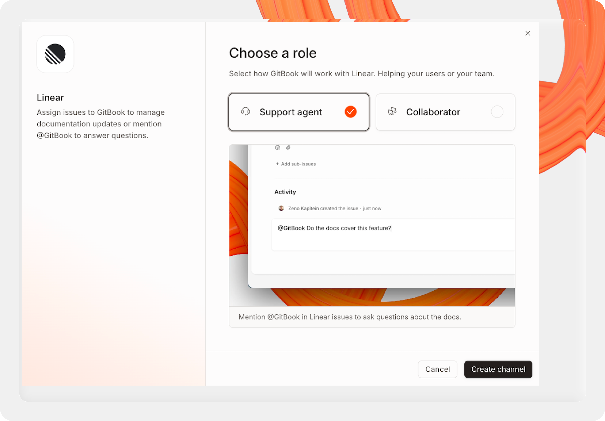

# Channels


#### Channels are in early access

We’re slowly rolling out access to channels. Stay tuned for more progress on the features below.


Channels bring [AI Assistant](../ai-for-your-readers/gitbook-ai-assistant.md) and [GitBook Agent](overview.md) into the tools your team already uses. Once connected, your team can mention `@GitBook` in Slack, GitHub, or Linear to ask questions, open change requests, and keep your docs up to date — without leaving their existing workflow.

When you add a channel, you choose how GitBook shows up in that tool. Each configuration runs in one of two modes:

**Support agent:** AI Assistant answers questions from your team or visitors directly in the channel. Ask a question, get an answer pulled from your docs. In Slack, citations in these replies link to the published site URL for the docs they reference. For example, a cited answer links to your docs site, not `app.gitbook.com`.

**Collaborator:** GitBook Agent joins as a teammate. Mention `@GitBook` to open change requests, request edits, or keep your docs in sync with what’s happening in that tool. In Slack, messages can link to `app.gitbook.com` when they reference internal workflow context, such as a change request or draft content. When GitBook Agent creates a change request from a channel, it automatically links it to the originating thread, issue, or pull request.

You can run multiple configurations per channel — for example, Support Agent mode for one customer-facing Slack channel, and Collaborator mode in another channel for your docs team.

To add a channel, open your site’s **Settings** and click **Channels**.

Use Channels when support questions, bug reports, or product feedback start in Slack, GitHub, Linear, or Jira and you want GitBook to respond in place.


#### Looking to embed AI Assistant in your website or product?

Head to [embedding](../publish/embedding/ "mention") to learn how to embed AI Assistant.


<figure><figcaption></figcaption></figure>

### Available channels

<table data-view="cards"><thead><tr><th></th><th><select><option value="mjZVekTsgGQo" label="In progress" color="blue"></option><option value="exlMMXLVjkth" label="Planned" color="blue"></option><option value="WK4vEyJjJM8h" label="Available" color="blue"></option></select></th><th></th><th data-hidden data-card-target data-type="content-ref"></th></tr></thead><tbody><tr><td><strong>Slack</strong></td><td>Available</td><td></td><td></td></tr><tr><td><strong>Linear</strong></td><td>Available</td><td></td><td></td></tr><tr><td><strong>GitHub</strong></td><td>Available</td><td></td><td></td></tr><tr><td><strong>Jira</strong></td><td>Available</td><td></td><td></td></tr></tbody></table>

### Coming soon

<table data-view="cards"><thead><tr><th></th><th><select><option value="mjZVekTsgGQo" label="In progress" color="blue"></option><option value="exlMMXLVjkth" label="Planned" color="blue"></option><option value="WK4vEyJjJM8h" label="Available" color="blue"></option></select></th><th></th><th data-hidden data-card-target data-type="content-ref"></th></tr></thead><tbody><tr><td><strong>Discord</strong></td><td>Planned</td><td></td><td></td></tr><tr><td><strong>Intercom</strong></td><td>Planned</td><td></td><td></td></tr><tr><td><strong>Microsoft Teams</strong></td><td>Planned</td><td></td><td></td></tr><tr><td><strong>Google Chat</strong></td><td>Planned</td><td></td><td></td></tr><tr><td><strong>Request a channel</strong></td><td></td><td><i class="fa-arrow-up-right-from-square">:arrow-up-right-from-square:</i></td><td><a href="https://github.com/orgs/GitbookIO/discussions/new?category=feature-requests">https://github.com/orgs/GitbookIO/discussions/new?category=feature-requests</a></td></tr></tbody></table>

### Overview

Channels connect GitBook to external workflows.

They let you:

* Answer questions without leaving the source conversation.
* Bring existing docs context into support and product workflows.
* Turn important conversations into docs updates with [GitBook Agent](overview.md).

Use Channels when the conversation starts outside GitBook, but the answer or follow-up belongs in your docs process.

### Supported platforms

Channels support these platforms:

* **Slack** for conversations and support threads.
* **GitHub** for issues, pull-request context, and discussion workflows.
* **Linear** for issue tracking and product feedback workflows.
* **Jira** for turning tickets into documentation updates.

Each platform uses the same core model.

GitBook receives supported events from the connected platform, gathers context from your knowledge, and responds through either [AI Assistant](../ai-for-your-readers/gitbook-ai-assistant.md) or [GitBook Agent](overview.md).

### Roles and permissions

Channels support two roles:

* **Collaborator** — can make changes.
* **Support agent** — provides read-only information.

Choose the role based on what the channel needs to do.

#### Collaborator

Use **Collaborator** when the channel must help turn conversations into documentation work.

A collaborator channel can use GitBook Agent to help create or update docs work in GitBook, such as opening or progressing a change request.

#### Support agent

Use **Support agent** when the channel only needs to answer questions.

A support agent channel uses existing docs and connected knowledge to reply with read-only context. It does not make content changes.

### How it works

Channels handle incoming events from your connected platform.

An incoming event can be a new message, a mention, an issue update, or other supported activity from Slack, GitHub, Linear, or Jira.

GitBook processes those events in four steps:



### Receive an event

The connected platform sends a supported event to GitBook through the channel you installed.



### Gather context

GitBook looks up the relevant docs context and any other knowledge available to the site.



### Apply the channel role

If the channel is a **Support agent**, GitBook returns read-only information.

If the channel is a **Collaborator**, GitBook can also turn the conversation into docs work through GitBook Agent.



### Reply in the source tool

The response appears back in Slack, GitHub, Linear, or Jira, so the workflow stays in one place.




Exact event coverage depends on the platform and your early access rollout. If a trigger is not available in your workspace yet, it has not been documented publicly.


### Install and authorization

To install a channel, open your site dashboard and choose **Settings → Channels**.

Then choose the platform you want to connect.

Slack, GitHub, and Linear use an OAuth or app-install flow. GitBook sends you to the platform, you approve access, and then you return to GitBook to finish setup.


Platform-specific permission scopes and admin requirements are not fully documented yet.

Review the authorization screen carefully before you approve access.






### Start the install

In **Settings → Channels**, select **Slack**.



### Authorize Slack

Sign in to Slack if needed.

Then choose the Slack workspace where you want to install the channel and approve the requested access.



### Finish setup in GitBook

After Slack redirects you back, finish the channel setup in GitBook.

Choose the role the channel should use and save the configuration.







### Start the install

In **Settings → Channels**, select **GitHub**.



### Authorize GitHub

Sign in to GitHub if needed.

Then choose the personal account or organization where you want to install the GitBook app and approve the requested access.



### Finish setup in GitBook

After GitHub redirects you back, finish the channel setup in GitBook.

Choose the role the channel should use and save the configuration.







### Start the install

In **Settings → Channels**, select **Linear**.



### Authorize Linear

Sign in to Linear if needed.

Then choose the Linear workspace you want to connect and approve the requested access.



### Finish setup in GitBook

After Linear redirects you back, finish the channel setup in GitBook.

Choose the role the channel should use and save the configuration.





Connect Jira to your GitBook site, then add the `gitbook` label to a ticket. GitBook Agent uses the ticket to draft a change request for your team to review.

#### Before you start

You need the following:

* Admin access to your GitBook site, with Channels available and GitBook Agent enabled and unpaused.
* A Jira Cloud site, an Atlassian account email, and an API token for that account. The account needs access to the projects you want to use and permission to comment on and link issues.

#### Connect Jira



### Start setup

Open your site’s **Settings → Channels**. Under **Jira**, click **Add configuration**.

Jira uses the **Collaborator** role to help your team maintain documentation.



### Connect your Jira account

Enter the following details:

* **Jira site URL:** your Jira Cloud URL, such as `https://your-site.atlassian.net`.
* **Account email:** the email address of the Atlassian account that created the token.
* **Jira API token:** [create an API token in Atlassian](https://id.atlassian.com/manage-profile/security/api-tokens), then paste it here.

Click **Connect Jira**. Once the connection succeeds, GitBook shows the available projects.



### Finish setup in GitBook

Choose the projects you want GitBook to handle. Leaving the selection empty includes all projects accessible to the connected account. Only issues labeled `gitbook` start documentation work.

Set **Jira status when merged** to **Done**, or the equivalent status in your project’s workflow, so merging the change request also completes the ticket. Click **Save**. GitBook confirms with a “Jira configuration saved” message.



#### Create a change request from a ticket



### Describe the documentation change

Open or create a Jira ticket in one of the projects covered by your configuration. Give it a clear title and describe what the docs should say.

For example, use the title “Document API key rotation” and include the rotation steps, who can perform them, and what happens to the old key.



### Add the `gitbook` label

Add `gitbook` to the ticket’s labels and save it.

GitBook Agent drafts a change request from the ticket’s title and description, then adds a comment and a link to the change request in Jira.



### Review the draft

Follow the link from Jira to open the change request in GitBook. Review the proposed changes, make any edits, and merge when the documentation is ready.



#### Optional: request another edit from Jira

While the change request is open, add a comment containing `@gitbook` and the change you want. For example:

> @gitbook Add a note explaining when the old API key stops working.

GitBook Agent updates the linked draft and posts an update comment in Jira. Editing the ticket’s title or description alone does not request another edit.



### Feedback and reactions

Reactions let your team give quick feedback on channel replies.

Use reactions when you want to signal whether a response was helpful.

That feedback helps GitBook understand which responses are working well in real workflows.


The exact reaction mapping is not documented yet and can vary by platform during early access.

