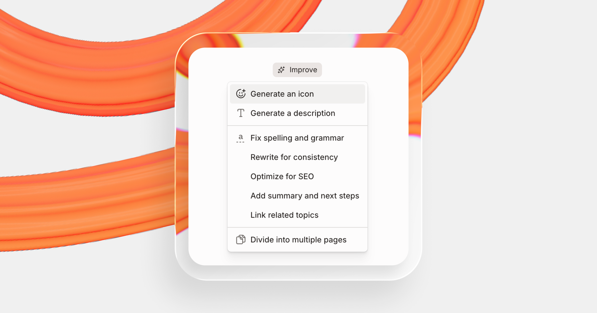

# Writing with GitBook Agent

GitBook Agent is a powerful tool for generating content for your documentation in GitBook.

The Agent can do everything from writing short passages of text on your page, to editing existing blocks and creating new pages and more in a change request.


#### GitBook Agent follows your style guide

Define your team’s writing rules in a [style guide](../create-content/styleguide/), and the Agent treats it as the source of truth whenever you ask it to help. It loads your style guide’s **first page** into context on every task, so keep your main rules there.

You can also [add short custom instructions](overview.md#add-a-style-guide-and-custom-instructions) at a site level.


### What can GitBook Agent do?

GitBook Agent is deeply integrated into the GitBook app, so it understands the blocks you can create in the editor, and the wider content of your section.

That means you can use the Agent to:

* Write new content based on your prompts
* Search through existing pages and update specific content
* Reformat content to make the most of GitBook’s different blocks
* Update code samples
* Move content around between pages
* Add new pages in specific locations

### How to interact with GitBook Agent

There are a few ways to work with GitBook Agent:

* Open the Agent from anywhere in GitBook and tell it what you need
* Plan and implement a new change request with GitBook Agent
* Tag the Agent in a comment on a block
* Create new content on an empty line on your page

Let’s run through each of these to find out how they work.

#### Open GitBook Agent

GitBook Agent is available anywhere in your organization, not only in a change request. Click **Agent** in the bottom-right corner of the app to open a new conversation. The conversation keeps running as you move between pages.

A new conversation suggests a few prompts to get started, such as **What does this space cover?** or **Find outdated content**. GitBook Agent reads the space you're in, and opens a change request when you ask for edits.

Each conversation opens as a tab next to the **Agent** button. Use the buttons in the conversation's header to:

* **Anchor as side panel:** keep the Agent in view while you work
* **Minimize:** hide the conversation and come back to it later
* **Close:** close the conversation

To find a past conversation, click the chat history icon next to the **Agent** button. Conversations are grouped by date, and you can filter them by name.

GitBook Agent names each conversation for you. To rename one, click its name at the top of the conversation and type a new name.

You can also open the Agent from the editor. Select text, start an empty block, use **Improve** in the page header, or use a comment's actions. The conversation opens with the page and your selection already attached.

The Agent works with your permissions. It reads what you can read, and edits and comments only where you can.

Write a prompt for the Agent to follow — it will explain what it’s doing as it follows your instructions, with the changes appearing in your section as it works.

You can give follow-up instructions or clarify steps, or edit the content of your section directly at any point, allowing you to work alongside GitBook Agent.

#### Implement a change request with GitBook Agent

Click **Edit** in the section header to open the change request dialog.

Enter a **Title** for the change request, and describe the changes you want in **Description**. GitBook Agent works from both.

Click **Implement with GitBook Agent**. GitBook creates the change request, and the Agent starts carrying out your instructions. At every stage, the Agent will tell you what it’s doing in its conversation.

When it’s done, you can edit the content yourself directly on the page, or give the Agent more instructions to continue refining your changes.

#### Tag GitBook Agent in a comment

If you want the Agent to review a specific block on your page, you can tag it in a comment and tell it what you need. Click **Comment on block** and tag @gitbook to tag the Agent, then tell it what you want it to do.

GitBook Agent will update the content based on your prompt, then reply to your comment telling you what it did.

#### Improve page content with GitBook Agent

<figure><figcaption></figcaption></figure>

The **Improve** menu gives you a choice of presets that tell GitBook Agent to carry out common actions to improve your page content.

You can access the **Improve** menu from the editor by hovering over the page title, or by opening the page’s **Actions menu** <picture><source srcset="../.gitbook/assets/25_01_10_actions_icon_dark.svg" media="(prefers-color-scheme: dark)"></picture>.

From the Improve menu, you can tell the Agent to:

* Add an icon for the page
* Generate a page description based on its content
* Fix spelling and grammar
* Rewrite for consistency with other pages
* Optimize for SEO
* Add a summary and next steps section
* Link to related topics and pages
* Divide the single page into multiple pages

The first two options are conditional — they change based on your page content. So if your page already has an icon and description, you won’t see those choices in the menu.

Click any option and the Agent will instantly get to work on your task.

#### Create new content in an empty block

You can use GitBook Agent to create content on any empty line on your page. It can create all kinds of content — formatted in Markdown — including code samples, templates, page summaries and more.

Press `Space` on any empty line, or type `/` and choose **Write with AI** to launch GitBook Agent.

You can instantly start typing any prompt you want. GitBook Agent will analyze the prompt and generate content based on it. For example:

> Write me a two-paragraph overview explaining why documentation is important for product teams.

Alternatively, you can choose from one of the suggested prompts or prompt starters:

* **Continue writing** – GitBook Agent will analyze the content on your current page and then generate more content based on that.
* **Explain…** – Choose this, then tell GitBook Agent what you want it to explain. This isn’t limited by content on your page, so you can ask it to explain anything at all.
* **Summarize** – Summarize all the content on your page. This is great for writing a TL;DR at the bottom of a detailed document, or adding a quick summary at the top for people just checking in.
* **Explain this** – This will explain the complex information on your page in simpler language — including explaining acronyms and other jargon. This is perfect if the page you’re reading involves a lot of complex information, or you want to add an explainer for less technical folks.
* **Translate** – Translate your current page into one of a set number of languages. If you want to translate into a language that’s not on the list, simply type it into the prompt box.

### Write effective prompts for GitBook Agent 

GitBook Agent is like a teammate that’s great at taking directions. You need to give it clear instructions and context to get the best results from it.

Here are some quick tips for writing good prompts:

* **Break it down** – The Agent is best at completing focused tasks. Break down complex projects into smaller steps and ask the Agent to complete them one at a time.
* **Be specific** – Generic prompts like `@gitbook improve this page` will apply general best practices, but without more specific guidance the Agent may not achieve the goal you had in mind.
* **Focus on outcomes** – If you’re hearing about a specific problem customers are having, tell the Agent about those problems — or the outcomes you want to achieve. It will suggest improvements based on those outcomes.
* **Give direct instructions** – If you want the Agent to use a stepper block for a step-by-step guide, or add an FAQ section with a bunch of expandable blocks, tell it precisely what to do to get the right results the first time.
* **Use broad prompts for wider improvements** – For maintenance tasks like fixing typos, updating a feature name across pages or removing specific block types from your docs, you can use commands like `@gitbook replace all instances of v2.3.9 with v2.4.0`.
