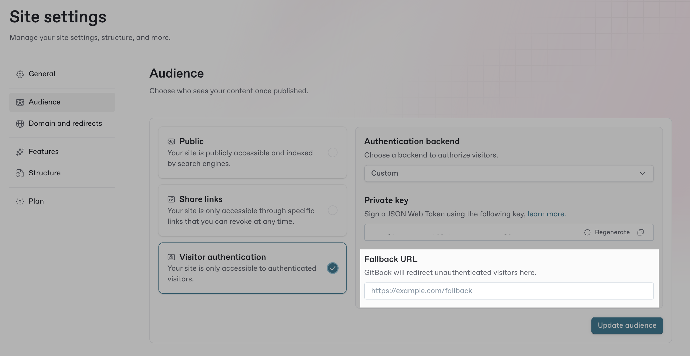

# Hosting your own login page

Use your own authentication service to sign visitors in to your docs site. This works for two setups:

* **Your whole site is private.** Set your site’s audience to authenticated access first. See [Enabling authenticated access](enabling-authenticated-access.md).
* **Your site is public, with extra content for signed-in visitors.** Keep the audience public and enable adaptive content. For a full walkthrough, see [how-to-show-private-content-to-signed-in-visitors-on-a-public-docs-site.md](../../../../guides/docs-personalization-and-authentication/how-to-show-private-content-to-signed-in-visitors-on-a-public-docs-site.md "mention").


If you are using one of the authentication providers we support or have an [OpenID Connect](https://auth0.com/docs/authenticate/protocols/openid-connect-protocol) (OIDC) compliant backend, check out our integration guides for a more streamlined setup:\
\
[Auth0](setting-up-auth0.md) | [Azure AD](setting-up-azure-ad.md) | [Okta](setting-up-okta.md) | [AWS Cognito](setting-up-aws-cognito.md) | [OIDC](setting-up-oidc.md)


### How sign-in works

On a private site, GitBook sends every visitor who isn’t signed in to your login page. On a public site, visitors start from a sign-in link.

1. GitBook redirects the visitor to your login URL and adds a `location` query parameter with the page they started from.
2. Your login page signs them in.
3. Your backend creates a JSON Web Token (JWT) signed with your site’s private key. To adapt content, the token includes the visitor’s claims.
4. Your backend redirects the visitor to the `location` page on your docs site, with the token in a `jwt_token` query parameter or a cookie.

### Overview

To set up a custom authentication system for your GitBook site, follow these key steps:



[**Create a custom backend to authenticate your users**](setting-up-a-custom-backend.md#id-1.-create-a-custom-backend-to-authenticate-your-users)

Implement a backend that prompts users to log in and authenticate them.



[**Sign and pass a JWT token to GitBook**](setting-up-a-custom-backend.md#id-2.-sign-and-pass-a-jwt-token-to-gitbook)

Create a JWT token and sign it with your site’s private key.



[**Configure a login URL**](setting-up-a-custom-backend.md#id-3.-configure-a-login-url)

Configure a URL to be used when an unauthenticated visitor accesses your site.



[**Set up multi-tenant authenticated access (optional)**](setting-up-a-custom-backend.md#id-4.-set-up-multi-tenant-authenticated-access-optional)

Configure your backend to handle authentication across multiple GitBook sites.



[**Configure your backend for adaptive content (optional)**](setting-up-a-custom-backend.md#id-5.-configure-your-backend-for-adaptive-content-optional)

Configure your backend to work with adaptive content in GitBook.



### 1. Create a custom backend to authenticate your users

To sign visitors in, you need a server that can handle login and authentication.

Your backend should:

* Prompt users to log in using your preferred authentication method.
* Validate user credentials and authenticate them.
* Generate and sign a **JSON Web Token (JWT)** upon successful authentication.
* Redirect users to GitBook with the JWT included in the URL, or stored in a cookie.

### 2. Sign and pass a JWT token to GitBook

Once your backend authenticates a user, it must **generate a JWT** and **pass it to GitBook** when **redirecting** them to your site. The token should be signed using the **private key** shown in your site’s audience settings. See [Configure a login URL](setting-up-a-custom-backend.md#id-3.-configure-a-login-url).


If your site is served under a [custom domain](../../custom-domain/), you can store the signed JWT in a `gitbook-visitor-token` cookie on your domain instead of adding it to the redirect URL. Learn more in [Signed cookie](../../adaptive-content/enabling-adaptive-content/cookies.md#signed-cookie).


The following example should demonstrate what a login request handler in your custom backend could look like:


```typescript
import { Request, Response } from 'express';
import * as jose from 'jose';

import { getUserInfo } from '../services/user-info-service';
import { getFeatureFlags } from '../services/feature-flags-service';

const GITBOOK_VISITOR_SIGNING_KEY = process.env.GITBOOK_VISITOR_SIGNING_KEY!;
const GITBOOK_DOCS_URL = 'https://mycompany.gitbook.io/myspace';

export async function handleAppLoginRequest(req: Request, res: Response) {
    // Your business logic for handling the login request
    // For example, checking credentials and authenticating the user
    //
    // e.g.:
    // const loggedInUser = await authenticateUser(req.body.username, req.body.password);
    
    // Generate a signed JWT
    const gitbookVisitorJWT = await new jose.SignJWT({})
        .setProtectedHeader({ alg: 'HS256' })
        .setIssuedAt()
        .setExpirationTime('2h') // Arbitrary 2-hour expiration
        .sign(new TextEncoder().encode(GITBOOK_VISITOR_SIGNING_KEY));
    
    // Redirect the user to GitBook with the JWT token in the URL
    const redirectURL = `${GITBOOK_DOCS_URL}/?jwt_token=${gitbookVisitorJWT}`;
    res.redirect(redirectURL);
}
```


#### Log visitors out of their GitBook session

To sign a visitor out of their GitBook session, redirect them to your site URL with `~gitbook/auth/logout` appended:

`https://mycompany.gitbook.io/myspace/~gitbook/auth/logout`

This endpoint only signs the visitor out of GitBook. If you also want to sign them out of your own identity provider, handle that separately in your own logout flow.

### 3. Configure a login URL

GitBook redirects visitors to the login URL to sign in: on a private site when they aren’t signed in, and on any site when they use a sign-in link.

This URL should point to a handler in your custom backend, where you can prompt them to log in, authenticate and then redirect them back to your site with the JWT included in the URL.

For instance, if your login screen is located at `https://example.com/login`, you should include this value as the login URL.

To configure the login URL:

1. In your docs site, go to **Settings → Audience**.
2. Under **Configure authentication**, set **Authentication backend** to **Custom**.
3. Copy the **Private key**. Your backend uses it to sign tokens.
4. In **Login URL**, enter the address of your login handler.
5. Optional: in **Logout URL**, enter the page to show visitors after they sign out.
6. Click **Save**.

**Configure authentication** appears when your site’s audience is authenticated access, or when adaptive content is enabled.

<figure><figcaption><p>Configure a login URL</p></figcaption></figure>

#### Use GitBook’s login endpoint

If you want a sign-in link on your published site, link to `<publishedSiteURL>/~gitbook/auth/login`.

This endpoint redirects the visitor to the authentication backend configured for the site. It also adds a `location` query parameter that matches the page they started from.

This is useful for header links and other entry points where you want to send visitors back to the same page after sign-in.

When redirecting to the login URL, GitBook includes a `location` query parameter to the login URL that you can leverage in your handler to redirect the user to the original location of the user:

```javascript
const gitbookVisitorJWT = await new jose.SignJWT({})
    .setProtectedHeader({ alg: 'HS256' })
    .setIssuedAt()
    .setExpirationTime('2h') // Arbitrary 2-hour expiration
    .sign(new TextEncoder().encode(GITBOOK_VISITOR_SIGNING_KEY));
    
// Redirect to the original GitBook docs URL with the JWT included as jwt_token query parameter
// If a location is provided, the user will be redirected back to their original destination
const redirectURL = `${GITBOOK_DOCS_URL}/${req.query.location || ''}?jwt_token=${gitbookVisitorJWT}`;
res.redirect(redirectURL);
```


Because GitBook relies on the `location` search param, you cannot use it in your login URL. For example, `https://auth.gitbook.com/?location=something` is not a valid login URL.


#### Redirect MCP authorization requests

When a visitor connects to the [MCP server](../../../ai-for-your-readers/mcp-servers-for-published-docs.md) of your published docs, GitBook redirects them to your authentication backend. The redirect includes a `location` parameter containing the path to the MCP authorize endpoint, which carries a `gb_oauth_state` value, like this:

```
~gitbook/oauth2/v1/<site-id>/authorize?gb_oauth_state=<consent_state>
```

Your backend should use this path to build the final redirect back to your GitBook site.

GitBook starts this flow from one of two endpoints, depending on how your site is configured:

* `~gitbook/mcp/auth` for partially authenticated sites with adaptive content enabled.
* `~gitbook/mcp` for sites using authenticated access.

Once your backend has authenticated the visitor, build the return URL by appending the `location` path to your GitBook site’s base URL. Leave the `gb_oauth_state` query parameter as is, and add a `jwt_token=<token>` parameter containing the signed JWT your backend generated.

The final URL your backend redirects the visitor to, should look like this:

```
https://<publishedSiteURL>/~gitbook/oauth2/v1/<site-id>/authorize?gb_oauth_state=<consent_state>&jwt_token=<token>
```

#### Use GitBook’s logout endpoint

If you want a sign-out link on your published site, link to `<publishedSiteURL>/~gitbook/auth/logout`.

This endpoint signs the visitor out of their GitBook session.

### 4. Set up multi-tenant authenticated access (optional)

If you’re using GitBook as a platform to provide content to your different customers, you probably need to set up multi-tenant authenticated access. Your authentication backend needs to be responsible for handling authentication across multiple different sites. This is possible in GitBook with a few small tweaks to your custom authentication backend code.

#### Adding all tenants to your authentication server

Your authentication backend will need to know the JWT signing keys and the URLs of all the GitBook sites you expect it to handle. If you have two sites in your organization for Customer A and Customer B, you can imagine your authentication code storing such mapping:

```typescript
const CUSTOMER_A = {
  jwtSigningKey: 'aaa-aaa-aaa-aaa',
  url: 'https://mycompany.gitbook.io/customer-a'
};

const CUSTOMER_B = {
  jwtSigningKey: 'bbb-bbb-bbb-bbb',
  url: 'https://mycompany.gitbook.io/customer-b'
};
```

#### Giving your authentication server additional context

When GitBook is unable to authenticate a user's request, it redirects them to the login URL. This URL points to your authentication backend, which is responsible for authenticating the user and redirecting them back to the requested content.

To support multiple tenants, your authentication backend needs to know which GitBook site the user is meant to access. This information can be passed in the login URL.

So for example, you could set up the login URLs for each site as follows:

Your authentication backend can then check this information and handle the redirection to the correct site accordingly:

```javascript
const customerInfo = req.query.site === 'customer-a' ? CUSTOMER_A : CUSTOMER_B;
  
const gitbookVisitorJWT = await new jose.SignJWT({})
    .setProtectedHeader({ alg: 'HS256' })
    .setIssuedAt()
    .setExpirationTime('2h') // Arbitrary 2-hour expiration
    .sign(new TextEncoder().encode(customerInfo.jwtSigningKey));
    
// Redirect to the original GitBook docs URL with the JWT included as jwt_token query parameter
// If a location is provided, the user will be redirected back to their original destination
const redirectURL = `${customerInfo.url}/${req.query.location || ''}?jwt_token=${gitbookVisitorJWT}`;
res.redirect(redirectURL);
```

### 5. Configure your backend for adaptive content (optional)

To leverage the Adaptive Content capability in your authenticated access setup, you can include additional user attributes (claims) in the payload of the JWT that your custom backend generates and includes in the URL when redirecting the user to the site.

These claims when included in the JWT are used by GitBook to [adapt content](../../adaptive-content/adapting-your-content.md) dynamically for your site visitors.

Putting it all together, the following code example demonstrates how you could include these claims in the JWT, which can then be used by GitBook to adapt content for your visitors:


```typescript
import { Request, Response } from 'express';
import * as jose from 'jose';

import { getUserInfo } from '../services/user-info-service';
import { getFeatureFlags } from '../services/feature-flags-service';

const GITBOOK_VISITOR_SIGNING_KEY = process.env.GITBOOK_VISITOR_SIGNING_KEY!;
const GITBOOK_DOCS_URL = 'https://mycompany.gitbook.io/myspace';

export async function handleAppLoginRequest(req: Request, res: Response) {
    // Your business logic for handling the login request
    // For example, checking credentials and authenticating the user
    //
    // e.g.:
    // const loggedInUser = await authenticateUser(req.body.username, req.body.password);
    
    // For the purpose of this example, assume a logged-in user object
    const loggedInUser = { id: '12345' }; // Replace with actual authentication logic

    // Retrieve user information to pass to GitBook
    const userInfo = await getUserInfo(loggedInUser.id);
    
    // Generate a signed JWT and include the user attributes as claims
    const gitbookVisitorClaims = {
        firstName: userInfo.firstName,
        lastName: userInfo.lastName,
        isBetaUser: userInfo.isBetaUser,
        products: userInfo.products.map((product) => product.name),
        featureFlags: await getFeatureFlags({ userId: loggedInUser.id })
    };
    
    const gitbookVisitorJWT = await new jose.SignJWT(gitbookVisitorClaims)
        .setProtectedHeader({ alg: 'HS256' })
        .setIssuedAt()
        .setExpirationTime('2h') // Arbitrary 2-hour expiration
        .sign(new TextEncoder().encode(GITBOOK_VISITOR_SIGNING_KEY));
    
    // Redirect the user to GitBook with the JWT token in the URL
    const redirectURL = `${GITBOOK_DOCS_URL}/?jwt_token=${gitbookVisitorJWT}`;
    res.redirect(redirectURL);
}
```


After setting up and configuring the right claims to send to GitBook, head to “[Adapting your content](../../adaptive-content/adapting-your-content.md)” to continue configuring your site. For a full walkthrough on a public site, see [how-to-show-private-content-to-signed-in-visitors-on-a-public-docs-site.md](../../../../guides/docs-personalization-and-authentication/how-to-show-private-content-to-signed-in-visitors-on-a-public-docs-site.md "mention").
